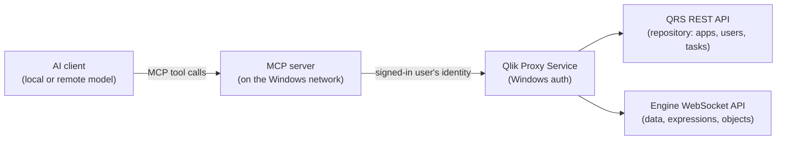

# Pattern 4 — AI Client on Qlik Sense via MCP

## Business problem

Patterns 1 and 2 put the LLM inside Qlik Sense. This pattern goes the other way: the AI assistant people already use (a desktop chat client, a coding agent, an internal assistant) needs to work with a Qlik Sense deployment from the outside.

**Example:** A Qlik administrator asks their assistant: *"Which apps haven't been reloaded in 90 days, and who owns them?"* An analyst asks: *"Compute revenue by region for this app and build me a chart for it."* Neither question needs a browser tab on the Qlik hub. Both need the assistant to reach the platform's own APIs under the right identity, and to be stopped before it does anything it should not.

The [Model Context Protocol (MCP)](https://modelcontextprotocol.io) is the open standard that makes this possible: a server exposes a set of tools, and any MCP-capable client can discover and call them.

---

## Architecture

The server is a thin translation layer. It does not hold Qlik data, and it does not decide what a user may see: it forwards each request to the platform as that user, and Qlik's own security rules answer.

---

## Why an MCP server suits on-premises Qlik Sense

Qlik Sense on Windows has no cloud-hosted AI surface to plug into, but it has two mature, well-documented APIs: the Qlik Repository Service (QRS) REST API for the platform's metadata and administration, and the Engine WebSocket API for everything that touches data. Both are reachable from inside the network and both already enforce the platform's access rules.

An MCP server turns those two APIs into a vocabulary an AI client understands, without changing Qlik Sense itself. Nothing is installed in the Qlik server, no extension is deployed, and no browser constraint applies. Unlike Pattern 1, there is no CORS problem to route around, because the caller is not a web page. And unlike Pattern 2, the LLM is not embedded in the Engine's expression evaluation: it sits beside the platform and drives it.

---

## Components

| Component | Role | Technology |
|-----------|------|-----------|
| AI client | Holds the conversation, decides which tools to call, shows approvals to the user | Any MCP-capable client |
| MCP server | Translates tool calls into Qlik API calls, applies the safety gates | Any MCP SDK |
| QRS REST API | Apps, streams, users, tasks, security rules | Qlik Sense Enterprise on Windows |
| Engine WebSocket API | Evaluating expressions, reading data, building objects | Qlik Sense Enterprise on Windows |

---

## Data flow

1. The user asks a question in the AI client.
2. The client picks a tool and calls the MCP server.
3. The server authenticates to the Qlik proxy as the signed-in user and calls the QRS or the Engine.
4. For reads, the result is trimmed and returned to the client. For anything that changes state, the server first returns a description of what it would do and changes nothing.
5. The user approves in the client, the call is repeated as confirmed, and only then does the change run.

---

## Design principles

**Act as the user, store nothing.** The server uses the standard Windows integrated handshake against the Qlik proxy, the same one a browser uses when a user opens the hub. There is no service account password and no long-lived token to hold. Whatever the user can do in Qlik, the assistant can do; whatever they cannot, it cannot. The identity is the real security boundary, and it is the one Qlik already administers.

**Read by default, preview then confirm for changes.** Reading, searching and calculating are never gated, because an assistant that asks permission to look at a field is one nobody uses. Anything that changes the platform follows a two-step shape: the first call returns a preview of the effect, and a second, explicit call performs it. The model cannot skip the preview, and the user sees what is about to happen before it does.

**Risk follows the arguments, not the tool.** The same operation can be harmless or serious depending on what it targets. Adding a chart to a personal working copy and overwriting a script on a live, published app are not the same act, so the gate is graded by the target and the consequence rather than by the verb.

**Scoped results.** Qlik estates can hold thousands of apps and millions of rows. Results are limited and summarised before they reach the model, which keeps context small, cost down, and the volume of data leaving the platform deliberate.

**Per-identity rate limiting.** Confirmed changes are rate limited for each user. A confused or looping assistant is stopped by arithmetic, not by hoping it notices.

**No new data store.** The server keeps no copy of Qlik metadata or data. There is nothing to synchronise, secure or audit beyond the platform itself.

---

## Key considerations

**What the safeguards do not prove:** A confirmation step shows that a request was approved, not that it was right. If the assistant picks the wrong app and the question reads sensibly, approving it does what was approved. The gates are a second line behind the identity, not a replacement for it. Run the server under an account with the rights the job needs, never a site administrator by default.

**No undo:** Qlik Sense Enterprise has no recycle bin. Deleted apps and overwritten scripts do not come back, so prevention matters more than recovery. Refusing to edit a published app in place, and working on a copy instead, is a better default than any amount of after-the-fact care.

**Data egress:** Every tool result is, in effect, sent to whatever model sits behind the client. That is the same question as in Patterns 1 and 2, with a sharper edge: an assistant can pull data on its own initiative. Decide per deployment which model is acceptable for which data. A local model keeps everything inside the boundary; a remote model needs the same governance as any other external API, and scoped results are the first control.

**Local versus remote models:** The server does not care which model drives the client. Tool use works best with capable models, and small local models are more likely to pick the wrong tool or malformed arguments. That makes the confirmation gate more important, not less.

**Deployment placement:** The server needs network reachability to the Qlik proxy and, for the Windows handshake, a machine in the right domain context. Running it on the user's own workstation keeps identity simple: it is already their session. Running it centrally means deciding how each user's identity is carried through, and is a larger design problem than it looks.

**Client permissions:** The AI client has its own permission prompts, and they show the real arguments of a call. They complement the server's gates: the client owns per-call consent, the server owns the Qlik-specific context that makes consent meaningful.

---

## Independent project, and where to look for the supported option

This is an independent side project, built and used by me. It is not a Qlik product, it is not endorsed or supported by Qlik, and it is described here as a pattern, not as something to depend on. Qlik is developing its own supported MCP server for client-managed Qlik Sense. For anything beyond experimentation, look to Qlik for the supported option.

---

## Prerequisites

- Qlik Sense Enterprise on Windows
- An MCP-capable AI client
- Network access from the MCP server to the Qlik proxy, QRS and Engine endpoints
- A Qlik user account with only the rights the intended tasks require
- A decision on which model, local or remote, may see which data
